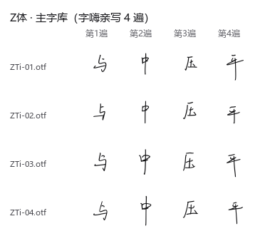

# PDF-Layer

把一段文字以**手写**的样子写进扫描版 PDF 的原版面空白处，并支持**行内数学公式**。

- 输入：一份无文字层的扫描 PDF + 待写内容（支持 `$...$` LaTeX 公式）
- 输出：保留原版式、在空白区叠加手写风格文本层的新 PDF

> **2026-11-25 字库重构（先看这段）**
>
> - 字库全部移到项目根的 `字体输出/`，由 `字体输出/字库索引.json` 注册；
>   代码不再硬编码 `ZTi-Han` / `ZTi-Sym` 目录名。
> - **第三方字体（龙藏/马善政/志莽行及 merged 版）已全部移出字库**，
>   移到 `归档/第三方字体_OFL/`。缺字不再自动换成别人的字体。
> - 新增 **字库工作台**：`fontlib/` + `fontlib_cli.py` + `fontlab_gui.py`，
>   可以自己选字、出模板、上传扫描、自动识别、微调、建库、校准。
>   用法见 [`docs/字库工作台.md`](docs/字库工作台.md)。
> - 下文关于「合并字体 / fetch_fonts / merge_symbols / 回退到 OFL 字体」的描述
>   是历史说明，**已不适用**；`merge_symbols.py`、`fetch_fonts.ps1` 已归档。

## 它做什么

| 能力 | 说明 | 状态 |
|---|---|---|
| 字迹合成 | 中文手写字体 + 逐字扰动（基线/字号/旋转/墨色）+ 整行正弦弯曲 | ✅ |
| 自建字库 | 选字 → 分页模板 → 扫描识别 → 自动校准 → 建库（字库工作台） | ✅ 见 docs/字库工作台.md |
| 公式排版 | 分式、根式、上下标、∑/∫ 上下限、矩阵、cases、自适应括号 | ✅ |
| **Z体** | 作者本人的手写笔迹字库，同一个字有最多 4 种不同写法 | ✅ 见下文 |
| 多段落版面 | 一页多段，各段独立框选区域、字号/行距/对齐 | ✅ |
| 背景导入 | 空白 A4 / 图片 / 已有 PDF 页，直接在上面写 | ✅ |
| PDF 内书写 | 手写层叠加回原 PDF 页，保留原文字/图形/其它页 | ✅ |
| **AI 接口** | 本地 HTTP API 供 AI 调用渲染（含内置答题提示词/工具 schema） | ✅ 见下文 |
| **做题/自动答题** | 导入作业页自动划题目区/答题区，AI 答案手写写回原 PDF（无窗口，CLI/API 驱动） | ✅ 见下文 |
| 版面分析 | 自动定位空白区、碰撞检测 | ❌ 未做，坐标目前手工给 |
| 笔迹轨迹合成 | RNN/笔画中心线变宽描边 | ❌ 二期 |

## 快速开始

```powershell
pip install -r requirements.txt
python demo.py                                               # 产出 out/demo_page.pdf
```

## 用法

```python
import symbols

hand = symbols.make_han_hand(size_pt=10.9, seed=20261118)

# 纯文本
img, w_pt, h_pt = hand.render_block("正文……", width_pt=404)

# 行内公式：$...$ 包住，作为整体参与排版（不会在中间断行）
img, w_pt, h_pt = hand.render_block(
    r"相电流 $I=\frac{220}{5}=44\,\mathrm{A}$，视在功率 $S=\sqrt{P^2+Q^2}$。",
    width_pt=404)

# 注回 PDF
H.paste_into_pdf("src.pdf", "out.pdf", {0: [(img, 226, w_pt, h_pt)]})
```

### 上下标（纯文本里直接写，不必包在 \$...\$ 里）

    x^2          -> x 的平方
    3^11         -> 3 的 11 次方（连续的同类字符整组当上标）
    x^{n+1}      -> 花括号整组
    a_1          -> 下标
    30°  25℃     -> 度数/摄氏度按角标渲染（自动抬起，不会看成 300）

> 说明：LaTeX 里 3^11 只把第一位当上标，手写场景下这样很容易打错，
> 所以这里改成「连续数字整组上标」。

### 公式支持的子集

分式 `\frac{}{}`、根式 `\sqrt{}` / `\sqrt[n]{}`、上下标 `^{}` `_{}`、
大运算符 `\sum \int \prod`（带上下限）、`\lim`、矩阵 `pmatrix/bmatrix/vmatrix`、
`cases`、`\left( \right)` 自适应括号、希腊字母、`\mathrm{}`、`\text{}`（可夹中文）。
不支持：自定义宏包、`\newcommand`、TikZ。

## Z体（ZTi）— 作者手写笔迹字库

`fonts/ZTi/` 是本项目自带的**真人笔迹字库**：字形全部来自作者本人的手写，
不是开源手写字体，也不是合成笔迹。字体家族名中文 **「Z体」**、英文 **ZTi**，
8 个文件同属一个家族，用 style 区分套次。

同一个字有多套不同形态时，`Hand` 会按「该字在本段里第几次出现」循环切换字库，
于是重复字不会每次长得一模一样——这是真人手写的自然特征。

| 子系列 | 文件 | 来源 | 覆盖 | 形态 |
|---|---|---|---|---|
| 主字库 | `ZTi-01.otf` … `ZTi-04.otf` | 用[字嗨](https://buttaiwan.github.io/writemyfont/)把同一张字表**亲笔写 4 遍**导出 | 35 个汉字 | **每字 4 个不同形态** |
| 扩充库 | `ZTi-Scan-01.ttf` … `ZTi-Scan-04.ttf` | 14 张平时写的真实手稿扫描、切字、轮廓化 | 115 个汉字 | 高频字 4 形态，其余为单形态复用 |

两系列并集 **137 个汉字**。字表清单与逐字形态数见 `fonts/ZTi/CHARS.txt`。

| 主字库（字嗨亲写 4 遍） | 扩充库（真实手稿切字） |
|---|---|
|  |  |

### 用法

**推荐：只用主字库 4 套**，风格统一、每个字都有 4 个形态：

```python
import glob
import hwrender as H

fonts = sorted(glob.glob("fonts/ZTi/ZTi-0*.otf"))     # 4 套
hand = H.Hand(fonts[0], variant_fonts=fonts[1:], seed=20261118)
img, w_pt, h_pt = hand.render_block("三相电路中，电压等于电流乘以电阻。", width_pt=404)
```

也可用现成工具自检、出对照样张：

```powershell
python multifont.py check  --fonts fonts/ZTi --expect 8
python multifont.py render --fonts fonts/ZTi
```

`check` 必须带 `--expect 8`（默认按 4 套校验）。输出里会看到
「set 5–8 vs set 1: 135 chars differ」，这是两套来源字表不同所致，属预期；
末尾 `RESULT: PASS` 即表示 8 套都能被 Pillow 正常加载。

想把覆盖字数拉满可以挂扩充库，但**不要两组混挂**：风格护栏会校验各套与主字体的
书写工具指纹，真迹扫描库的墨迹占比比字嗨高约 1.4 倍，混挂会被整体退回单套
（同字多形直接失效）。按来源分组、主字体与轮换套同组即可：

```python
scan = sorted(glob.glob("fonts/ZTi/ZTi-Scan-*.ttf"))   # 真迹扫描组
hand = H.Hand(scan[0], variant_fonts=scan[1:])
```

### 可视化控制台（GUI）

**Windows 上直接双击 `run_gui.bat` 即可打开**（启动器会自动挑带 tkinter 的
Python；WorkBuddy 沙箱自带的 Python 没有 tkinter，直接双击 `gui.py` 会闪退）。
其他平台或命令行里用 `python gui.py`。

**想整篇用自己的笔迹**：字体下拉框选
「ZTi 我的手写·字嗨 4 套」或「ZTi 我的手写·真迹扫描 4 套」，即以 Z体 作主字体、
同组另外 3 套自动进入同字多形轮换（复选框已自动勾上，可手动关）。Z体 未覆盖的
字会自动回退到全字表字体，不会出豆腐块；风格护栏的结论显示在预览区上方状态栏
（如「多套循环（覆盖率 96%）」或「覆盖率仅 56%，已退回单套」——退回单套时
仍是你的笔迹，只是同字不再变形）。

**默认字体**：下拉框第一项「★ 我的手写体（汉字+符号，全手写）」= 汉字 `ZTi-Han`（500 字，pass2 主 / pass1 变体）+ 数字/拉丁/希腊/符号 `ZTi-Sym`（默认固定 pass2；`ZTISYM_ROTATE=1` 可恢复 4 套轮换）；`symbols.make_han_hand()` 即此组合。

### 缺字与边界

- Z体 只覆盖常用正文用字，**不是全字表字体**。第三方回退字体已全部移出字库，
  缺字**不再换成别人的字体**，而是留空；GUI 状态栏会显示「缺 X 需补写」。
- 补字用「字库工作台」：选「补当前字库缺的字」→ 出模板 → 写完上传 →
  自动识别建库；也可以直接并入现有字库（老库字形 + 新写字形 = 一套）。
- 符号、拉丁字母与数字由 `ZTi-Sym`（204 字 × 4 遍）覆盖，不受汉字缺字影响。
- 公式里的 `$...$` 由独立公式层渲染，不走 Z体。
- 扩充库来自连笔行书手稿，少数切字块边缘保留了邻字残影（预览中「平」带
  「台」等），属已知限制；对观感要求高时请只用主字库。
- `python pack_ziti.py` 可从私人原件重建发布包：`fonts/user/pass*.otf`
  与 `out/my_ziti/fonts/pass*.ttf`。脚本只重写字体名（name 表 / CFF
  topDict），**不改任何字形轮廓**，并会逐字形断言轮廓、cmap、hmtx 一致。
  这两个源目录属私人资产，已在 `.gitignore` 中排除，不在本仓库内。

### 权利

Z体 是作者本人手写笔迹的数字化成果，**版权归作者所有，保留所有权利**
（Proprietary / All rights reserved），随本仓库公开仅供本项目使用与展示，
**未授予再分发或商用许可**。字体文件的 name 表已写入相应版权与授权声明。

> ⚠️ 本仓库为**公开仓库**。字库一经推送，笔迹轮廓即进入 Git 历史，
> 即便后续删除也仍可从历史或 fork 中取得，无法真正撤回。

## 符号字库（ZTi-Sym）— 数字 / 拉丁 / 希腊 / 符号手写

`字体输出/ZTi-Sym/` 是同一位作者手写的**符号字库**，204 个字：数字 `0–9`、拉丁大小写、
希腊大小写（含 `Ω Σ Δ Φ Ψ Π`）、运算符、集合逻辑、箭头、中英文标点、单位符号
`℃ ² ³`。同一张模板亲笔写 4 遍，得到 `pass1.ttf` … `pass4.ttf` 四套，每个字 4 种形态。

| 文件 | 内容 | 说明 |
|---|---|---|
| `字体输出/ZTi-Sym/pass1.ttf` … `pass4.ttf` | 每套 204 字，cmap 204，无空字形 | 符号 / 数字 / 拉丁 / 希腊 的手写字形 |
| `字体输出/字库索引.json` | 注册表 | 当前启用的符号库 |
| `字体输出/_资料/ZTi-Sym/` | 建库报告、预览图、旧备份 | 只读留档，不参与渲染 |

`symbols.py` 按优先级找字库：注册表当前符号库 → 环境变量 `ZTISYM_DIR` →
`../../字体输出/ZTi-Sym/` → 仓库内 `fonts/ZTi-Sym/`。找不到就退回主字体，
不再走「合并字体 + handstroke 骨架笔迹化」的旧路径。

启用方式：

- GUI 字体下拉框选「★ 我的手写体」（汉字库 + ZTi-Sym 固定 pass2；要 4 套轮换设 `ZTISYM_ROTATE=1`）；
- 代码里用 `from symbols import make_han_hand`，汉字与符号各走各的字库。

4 套按权重随机轮换：`pass1 : pass2 : pass3 : pass4 = 1 : 3 : 2 : 2`
（pass1 较潦草降频；pass2 最清楚，同时充当公式层主字体）。校准系数记在
`fonts/fontcal.json`，键是「项目相对路径」（`字体输出/ZTi-Sym/pass2.ttf`），
所以不同库的同名 `pass2.ttf` 不会串值。

> 版权同 Z体：真人手写笔迹，作者保留所有权利，仅供本项目使用与展示，
> 未授予再分发或商用许可。

## 汉字字库（ZTi-Han）— 手写汉字 500 字

`字体输出/ZTi-Han/` 是作者手写的**汉字字库**：500 个常用汉字，每字 2 种形态
（`pass1.ttf` / `pass2.ttf`，pass2 为主字体，pass1 作同字异形轮换）。先按
「电子电工答题」写 366 字，后按语料里缺的高频字补 134 个常用字（谐振、暂态、
损耗、铁芯、绕组、逻辑、编码、寄存器、饱和、截止…）。字体度量：upem 1000、
字面高 640 units、advance 1000、ascent 950 / descent −50，两套均无空字形。

| 文件 | 内容 | 说明 |
|---|---|---|
| `字体输出/ZTi-Han/pass1.ttf`、`pass2.ttf` | 每套 500 字，cmap 500，无空字形 | 手写汉字（pass2 主 / pass1 变体） |
| `字体输出/字库索引.json` | 注册表 | 当前启用哪个库、有哪些库、校准值 |
| `字体输出/_资料/ZTi-Han/` | 建库报告、对比图、旧备份 | 只读留档，不参与渲染 |

- GUI 默认字体「★ 我的手写体（汉字+符号，全手写）」= 汉字 `ZTi-Han` +
  数字/拉丁/希腊/符号 `ZTi-Sym`（默认固定 pass2：4 套之间同一个数字高度差可达
  40%，轮换会让同一段里的数字忽大忽小）；代码入口
  `symbols.make_han_hand(size_pt=...)`。
- 字号统一走「基础参数」：汉字墨迹高 = 0.948 × 渲染字号，数字/拉丁 = 汉字 × 0.86；
  校准就做在真实渲染字号 49.6px（12.4pt × 4）上，参数在 `fonts/fontcal.json`
  （`ref_px=49.6`、`han_ink_em=0.948`、`ZTi-Han size_scale≈1.52`）。公式层乘同一份
  `size_scale`，不再用写死的 1.65。
- 缺字：`ZTi-Han → 注册表里其它已启用汉字库 → 老 ZTi 亲笔库`；都没有就留空，
  GUI 提示缺哪些字。第三方字体不再参与回退（见文首重构说明）。
  2123 字题解语料按频次覆盖 **95.5%**（去重 80.8%），4.3.5 样文 100%。
- 扩字：用「字库工作台」（`fontlab_gui.py` / `fontlib_cli.py`），
  见 [`docs/字库工作台.md`](docs/字库工作台.md)。

> 版权同 Z体：真人手写笔迹，作者保留所有权利，仅供本项目使用与展示，
> 未授予再分发或商用许可。⚠️ 公开仓库，推送即进入 Git 历史，无法撤回。

## 图形界面（多段落 / 背景导入 / PDF 内书写）

```powershell
cd 源码\pdf-layer
py -3 gui.py          # 或双击 run_gui.bat
```

- **背景导入**：空白 A4（默认）/ 图片（PNG·JPG 等比铺满）/ 已有 PDF 的指定页，
  工具栏可翻页、清空背景。
- **多段落**：左侧段落列表增删/调序，每段有自己的矩形区域，画布上可拖动、
  拖 8 个手柄缩放，或「框选」在页面上拉框；每段独立字号/行距/对齐/抖动/种子/墨色，
  渲染时合成整页。
- **PDF 内直接书写**：导入 PDF → 选页 → 框选答题区 → 导出 PDF 时把透明手写层
  叠回原页（其余页与原文全部保留），默认另存 `out/gui_时间戳.pdf`；项目可存 JSON。
- **窗口/自适应**：记忆窗口几何、首次适应整页、重渲染不跳缩放、滚轮以光标为中心、
  中键/空格平移、双击复位、DPI 感知、小屏自动折叠日志。
- **界面**：`theme.py` 提供浅色/深色 ttk 主题与设计令牌，工具栏 + 卡片式侧栏 +
  整页画布 + 可折叠日志/控制台；旧控制台命令（`render`/`save pdf`/`size=`…）保留。
- 核心模型在 `page_model.py`（Page/Paragraph/背景/拼合/导出），GUI 与 AI 接口共用。

## AI 接口（供 AI 调用这个工具）

```powershell
cd 源码\pdf-layer
py -3 ai_api.py                 # http://127.0.0.1:8321
py -3 ai_api.py --self-test     # 28 项自测
```

| 端点 | 作用 |
|---|---|
| `GET /health` | 存活探测 |
| `GET /capabilities` | 字体/字表（字数随当前字库，默认 500 汉字 + 204 符号）/字号范围/段落 schema |
| `GET /llm/status` | 自动做题模型配置（脱敏）：是否已配置/模型名/端点 |
| `POST /worksheet/solve` | 自动做题：划题 → 模型作答 → 手写写回 PDF（也可只传 answers） |
| `POST /render` | 多段文本 → 手写 PNG/PDF（可带背景、返回 base64） |
| `POST /render_pdf` | 手写层叠加到指定 PDF 页，保留原文 |
| `POST /prompt` | 内置答题提示词（注入真实字表）+ tool schema |
| `POST /answer` | 答案文本 → 自动切段 + 可渲染 spec |

`ai_prompt.py` 的内置提示词约束 AI：**只用字表内的字**（字表按当前字库动态注入，
补字/换库后自动跟着变；表外字会回退渲染，提示词里如实说明）、
**考试答题风格**（先结论后步骤、精炼、不客套/不复述题干）、公式用支持子集、
输出 JSON `{"answer_text", "segments"}`；`tool_schema()` / `tool_schema_anthropic()`
可直接用于 function calling。示例见 `ai_client_example.py`，完整文档 `docs/AI接口说明.md`。
默认只监听 `127.0.0.1`、只写 `out/`。

## 做题（作业页自动判题区 + 自动答题）

**独立模块，不弹窗口**：命令行或 AI 接口驱动。

```powershell
cd 源码\pdf-layer
py -3 做题.py analyze 作业.pdf [--numbers "4.2.1,4.2.2,..."] --out layout.json
py -3 做题.py answer 作业.pdf --layout layout.json --answers answers.json --out 手写作答.pdf
py -3 做题.py run 作业.pdf --answers answers.json --out 手写作答.pdf

# 自动做题（需要模型）：划题 → AI 作答 → 手写作答 PDF，一步完成
$env:HANDWRITE_LLM_API_KEY = "sk-..."          # DeepSeek/OpenAI 兼容 Key
py -3 做题.py solve 作业.pdf --out 手写作答.pdf
# 扫描件：--numbers "4.2.1,4.2.2,..."；把模型答案另存手改：--answers-out answers.json
```

- **自动划区**：数字版 PDF 读文字层按题号（`1.` / `（1）` / `4.2.1` 多级）识别题块并提取文字；
  **插图（几何图/电路图/表格截图）也参与划区**：足够大的图片块并进题目区，答题区在插图前止步；
  扫描件按像素行投影分块、返回每题题干 crop（AI 读图），自动排除表头/页脚，答题区避开题干与插图。
- **答案渲染**：按每题 answer_rect 自动排版手写答案（12.4pt，放不下自动缩到 8pt，不截断），
  叠加回原作业 PDF，原内容逐页保留。
- **没有留白的题目页**：勾选「答案写到新空白页」（CLI `--blank-page` / HTTP
  `"answer_mode":"blank"`）后，每页作业后插空白页写答案，一题太长自动续页。
- **答案像人写作业**：提示词要求「解：」开头、先依据再公式代入再结果、「答：」收尾；
  渲染前把 `220/10` 这类斜杠自动转成**分数式**（分子/分母上下叠），乘法 ×、开方 √。
- **自动做题（接模型）**：`llm_client.py` 接 OpenAI 兼容接口（默认 DeepSeek）
  `POST /worksheet/solve` 一步完成「划题 → 模型作答 → 手写写回 PDF」；
  `GET /llm/status` 看模型配置；没配模型时返回题目+提示词（`needs_answers`），
  外部 AI 补 `answers` 后再调即可。配置：环境变量 `HANDWRITE_LLM_API_KEY`
  （可选 `HANDWRITE_LLM_BASE_URL` / `_MODEL` / `_VISION` / `_TIMEOUT` / `_MAX_TOKENS`）
  或 `llm.json`；默认等待 300 秒、最多 8192 tokens（题多/难题时可在「AI 设置」里调大，
  避免答到一半被掐断/截断）。
- **AI 接口**：`POST /worksheet/analyze`、`/worksheet/prompt`（做题提示词：字表按当前字库
  动态注入、公式写 `$...$`、只输出 `{"answers":{...}}`、每题可写字数约束）、
  `/worksheet/answer`。详见 `docs/做题接口.md`。

不想用命令行时打开**做题窗口**（独立 Tk 窗口，不唤起生成器 GUI）：划区 → 手动改答案 →
主动点「生成手写作答」才写 PDF（`py -3 做题窗口.py`）；未点生成不渲染、不写文件。

真实作业验收：`4第四章作业.pdf`（4 页扫描件、无文字层）每页 2/2/2/1 共 7 题零漏检零误检，
7 题答案全部写入各自页面答题区，原扫描内容像素级保留。

## 实现要点

- **坐标单位**：外部一律 pt，内部 `SCALE=4` 超采样（1pt=4px）。
- **墨色**：黑笔 `(16,16,18)`，逐字 alpha 抖动 220–255。
- **数字/拉丁调细**：公式与数字字形默认做「粗笔画自适应收边」（`FORMULA_THIN_LEVEL=140`；0 关闭），与汉字笔画齐平。
- **排版护栏**：防重叠按「墨迹」边缘判断，不能把贴图的透明内边距算进字距
  （否则字距从 11pt 被撑到 15.4pt，行宽膨胀 40%，长行右侧被画布裁掉）。
- **画布宽度**：先按行宽给足再按实际墨迹裁边，保证任何字号/种子下都不裁字。
- **符号笔迹化**（`handstroke.py`）：合并字体里的 Ω √ ≈ × ° ∑ π φ 是 Segoe UI Symbol 的
  **印刷体轮廓**，直接贴会显得不是同一支笔。做法是栅格化 → Zhang-Suen 细化取骨架 →
  变宽笔道重绘（起收笔渐细、笔压抖动、轻微旋转）。少数骨架拓扑会坏的符号
  （`∠ ≤ ≥ ° ∘`）改用人工描的笔道路径。
  注意 PIL 的 `font.getbbox()` 是**布局框**不是墨迹框，用它缩放骨架会把上标 ² ³ 撑成正常大小。
- **公式**：手写字体没有 OpenType MATH 表，画不出分式/根号结构。因此复用
  [MarkdownToHandwrite](https://github.com/lyc07/MarkdownToHandwrite)（MIT）的
  2D 公式排版内核（`vendor/mthw/`，见 `vendor/LICENSE-MarkdownToHandwrite`），
  只保留「解析 → 盒式布局 → 笔画化渲染」，输出透明 RGBA + 基线，贴到同一张 4x 画布。
  上游默认把希腊字母映射成形近汉字，本项目的 `formula.py` 改回真希腊字符；
  公式里的符号同样走 `handstroke` 笔迹化。
- **公式字体**：公式里的拉丁字母/数字默认用龙藏体（`math_font_path`），
  因为马善政楷书的连笔 `I` 会被读成 `9`，而公式里 I（电流）出现频率极高。
- **行距**：逐行按自身高度排布——纯文本行保持 20.2pt，含分式/根号的行自动加高；
  不采用「按最高行统一行距」，否则一条嵌套分式会把整段撑成双倍行距。

## 目录

```
hwrender.py        手写层渲染引擎（换行 / 逐字扰动 / 行内公式 / 注回 PDF）
handstroke.py      符号笔迹化（骨架提取 + 变宽笔道重绘）
formula.py         公式层适配器（复用 vendor/mthw，改符号映射，带缓存）
multifont.py       多套真人笔迹字库：字表生成 / 自检 / 同字多形对照样张
scanfont.py        手写稿扫描造字（旧 CLI；新流程用 fontlib/）
fontlib/           自建字库内核：字符集 / 分页模板 / 扫描识别 / 自动校准 / 建库 / 注册表
fontlib_cli.py     自建字库命令行（list / template / new / analyze / build / selftest）
fontlab_gui.py     字库工作台窗口（GUI 里的「字库工作台…」按钮打开）
docs/字库工作台.md   自建字库的使用说明（选字→模板→识别→微调→建库）
pack_ziti.py       把私人笔迹原件打包成公开发布的「Z体」字库
page_model.py      页面/段落模型 + 背景（图片/PDF）+ 拼合导出（GUI/AI 共用）
theme.py           界面主题（ttk 样式/色板/字号/深浅色）
ai_api.py          AI 接口（本地 HTTP：/render、/render_pdf、/prompt、/answer、做题/自动做题）
llm_client.py      自动做题的模型接入（OpenAI 兼容：DeepSeek/OpenAI/本地 Ollama）
ai_prompt.py       内置答题提示词 + 工具 schema（字库内字符约束/考试精炼风格）
worksheet.py       做题：作业页自动划题目区/答题区 + 答案手写渲染（spec v1.1）
做题.py            做题命令行（analyze / answer / run / solve，headless）
docs/做题接口.md    做题 CLI/HTTP 接口文档
ai_client_example.py  AI 接口调用示例
assets/            界面效果图（mockup）
docs/AI接口说明.md   AI 接口文档
demo.py            端到端演示（合成页面 → 手写层 → 注回 PDF）
preview.py         不依赖 PyMuPDF 的预览（输出 PNG）
fonts/ZTi/         Z体 老字库（作者亲笔 8 套，148 字；缺字回退用）
../../字体输出/      当前字库 + 注册表（ZTi-Han / ZTi-Sym / 自建库）
../../归档/第三方字体_OFL/  已移出的第三方字体（不参与渲染）
vendor/mthw/       第三方公式排版内核（MIT，见 vendor/LICENSE-MarkdownToHandwrite）
docs/交接说明.md   项目背景、调研结论、计算口径与 TODO
STATUS.md          当前进度与已知阻塞
```

## 已知问题

- **版面坐标是手工估算的**，不通用；通用化需要版面分析（P3）。
- 原始扫描件（4 页《电工学》第四章）不在仓库内，真实版面无法复现验证。
- 第三方回退字体已移出：字表外的字会留空，需要用手写补字（字库工作台）。
  旧的合并字体流程（Segoe UI Symbol）不再可用，相关脚本已归档。
- 公式层的笔画风格来自上游内核，与正文 `Hand` 的扰动是两套参数，观感可能略有差异。
- GUI 的文件选择/页码弹窗未做真人点击回归（底层导入函数已测）；PDF 背景每帧按
  200dpi 重解码（约 0.3–1.5s），大文本多段时可再优化缓存。
- AI 接口默认只听 `127.0.0.1`、无鉴权、只写 `out/`；对外暴露需自行加鉴权/代理。
- 做题模块的扫描件没有 OCR：题号需 `--numbers` 指定；题干文字为 null，AI 通过 crops 读图。
  教材页题干集中在页顶时，答题区按整页空白从上到下按题分配（页内答案顺序仍是 1→2）。
- 数字版 PDF 的插图已按图片块 bbox 参与划区；但题干本身就画在图片里、没有文字层时
  仍然无法识别题号（属于 OCR 范畴）。
