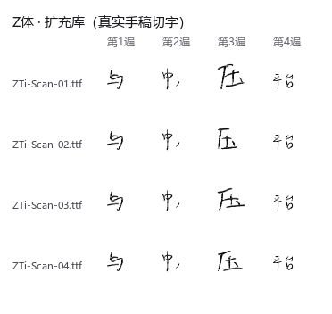

# PDF-Layer

把一段文字以**手写**的样子写进扫描版 PDF 的原版面空白处，并支持**行内数学公式**。

- 输入：一份无文字层的扫描 PDF + 待写内容（支持 `$...$` LaTeX 公式）
- 输出：保留原版式、在空白区叠加手写风格文本层的新 PDF

## 它做什么

| 能力 | 说明 | 状态 |
|---|---|---|
| 字迹合成 | 中文手写字体 + 逐字扰动（基线/字号/旋转/墨色）+ 整行正弦弯曲 | ✅ |
| 字形合并 | 把数学符号并入中文手写字体，消除「中文手写 + 符号印刷体」混排 | ✅ |
| 公式排版 | 分式、根式、上下标、∑/∫ 上下限、矩阵、cases、自适应括号 | ✅ |
| **Z体** | 作者本人的手写笔迹字库，同一个字有最多 4 种不同写法 | ✅ 见下文 |
| 版面分析 | 自动定位空白区、碰撞检测 | ❌ 未做，坐标目前手工给 |
| 笔迹轨迹合成 | RNN/笔画中心线变宽描边 | ❌ 二期 |

## 快速开始

```powershell
pip install -r requirements.txt
powershell -ExecutionPolicy Bypass -File .\fetch_fonts.ps1   # 拉字体 + 合并符号
python demo.py                                               # 产出 out/demo_page.pdf
```

`fetch_fonts.ps1` 需要 PATH 里有 `python`；若你的机器只有 `py` 启动器，把脚本里的
`python` 改成 `py -3`，或直接用 `python merge_symbols.py` 手动合并。

## 用法

```python
import hwrender as H

FONT = "fonts/MaShanZheng-Regular-merged.ttf"
hand = H.Hand(FONT, size_pt=10.9, seed=20261118)

# 纯文本
img, w_pt, h_pt = hand.render_block("正文……", width_pt=404)

# 行内公式：$...$ 包住，作为整体参与排版（不会在中间断行）
img, w_pt, h_pt = hand.render_block(
    r"相电流 $I=\frac{220}{5}=44\,\mathrm{A}$，视在功率 $S=\sqrt{P^2+Q^2}$。",
    width_pt=404)

# 注回 PDF
H.paste_into_pdf("src.pdf", "out.pdf", {0: [(img, 226, w_pt, h_pt)]})
```

### 公式支持的子集

分式 `\frac{}{}`、根式 `\sqrt{}` / `\sqrt[n]{}`、上下标 `^{}` `_{}`、
大运算符 `\sum \int \prod`（带上下限）、`\lim`、矩阵 `pmatrix/bmatrix/vmatrix`、
`cases`、`\left( \right)` 自适应括号、希腊字母、`\mathrm{}`、`\text{}`（可夹中文）。
不支持：自定义宏包、`\newcommand`、TikZ。

## Z体（ZTi）— 作者手写笔迹字库

`fonts/ZTi/` 是本项目自带的**真人笔迹字库**：字形全部来自作者本人的手写，
不是开源手写字体，也不是合成笔迹。字体家族名中文 **「Z体」**、英文 **ZTi**，
8 个文件同属一个家族，用 style 区分套次。

同一个字有多套不同形态时，`Hand` 会按「该字在本段里第几次出现」循环切换字库，
于是重复字不会每次长得一模一样——这是真人手写的自然特征。

| 子系列 | 文件 | 来源 | 覆盖 | 形态 |
|---|---|---|---|---|
| 主字库 | `ZTi-01.otf` … `ZTi-04.otf` | 用[字嗨](https://buttaiwan.github.io/writemyfont/)把同一张字表**亲笔写 4 遍**导出 | 35 个汉字 | **每字 4 个不同形态** |
| 扩充库 | `ZTi-Scan-01.ttf` … `ZTi-Scan-04.ttf` | 14 张平时写的真实手稿扫描、切字、轮廓化 | 115 个汉字 | 高频字 4 形态，其余为单形态复用 |

两系列并集 **137 个汉字**。字表清单与逐字形态数见 `fonts/ZTi/CHARS.txt`。

| 主字库（字嗨亲写 4 遍） | 扩充库（真实手稿切字） |
|---|---|
|  |  |

### 用法

**推荐：只用主字库 4 套**，风格统一、每个字都有 4 个形态：

```python
import glob
import hwrender as H

fonts = sorted(glob.glob("fonts/ZTi/ZTi-0*.otf"))     # 4 套
hand = H.Hand(fonts[0], variant_fonts=fonts[1:], seed=20261118)
img, w_pt, h_pt = hand.render_block("三相电路中，电压等于电流乘以电阻。", width_pt=404)
```

想把覆盖字数拉满，可以把 8 套一起挂上（`variant_fonts` 全部传入）。
代价是两种来源笔迹风格不同，同段里可能看得出「换了一支笔」：

```python
fonts = sorted(glob.glob("fonts/ZTi/*.otf") + glob.glob("fonts/ZTi/*.ttf"))
hand = H.Hand(fonts[0], variant_fonts=fonts[1:])
```

也可以直接用现成工具自检、出对照样张：

```powershell
python multifont.py check  --fonts fonts/ZTi --expect 8
python multifont.py render --fonts fonts/ZTi
```

`check` 必须带 `--expect 8`（默认按 4 套校验）。输出里会看到
「set 5–8 vs set 1: 135 chars differ」，这是两套来源字表不同所致，属预期；
末尾 `RESULT: PASS` 即表示 8 套都能被 Pillow 正常加载。

### 缺字与边界

- Z体 只覆盖常用正文用字，**不是全字表字体**。缺字时引擎自动回退到
  `*-merged.ttf`（四款 OFL 手写体），不会显示豆腐块；符号、拉丁字母与数字
  同样走回退字体。想让某段完全由 Z体 写出，需先把它包含的字加进字表。
- 公式里的 `$...$` 由独立公式层渲染，不走 Z体。
- 扩充库来自连笔行书手稿，少数切字块边缘保留了邻字残影（预览中「平」带
  「台」等），属已知限制；对观感要求高时请只用主字库。
- `python pack_ziti.py` 可从私人原件重建发布包：`fonts/user/pass*.otf`
  与 `out/my_ziti/fonts/pass*.ttf`。脚本只重写字体名（name 表 / CFF
  topDict），**不改任何字形轮廓**，并会逐字形断言轮廓、cmap、hmtx 一致。
  这两个源目录属私人资产，已在 `.gitignore` 中排除，不在本仓库内。

### 权利

Z体 是作者本人手写笔迹的数字化成果，**版权归作者所有，保留所有权利**
（Proprietary / All rights reserved），随本仓库公开仅供本项目使用与展示，
**未授予再分发或商用许可**。字体文件的 name 表已写入相应版权与授权声明。

> ⚠️ 本仓库为**公开仓库**。字库一经推送，笔迹轮廓即进入 Git 历史，
> 即便后续删除也仍可从历史或 fork 中取得，无法真正撤回。

## 实现要点

- **坐标单位**：外部一律 pt，内部 `SCALE=4` 超采样（1pt=4px）。
- **墨色**：黑笔 `(16,16,18)`，逐字 alpha 抖动 220–255。
- **排版护栏**：防重叠按「墨迹」边缘判断，不能把贴图的透明内边距算进字距
  （否则字距从 11pt 被撑到 15.4pt，行宽膨胀 40%，长行右侧被画布裁掉）。
- **画布宽度**：先按行宽给足再按实际墨迹裁边，保证任何字号/种子下都不裁字。
- **符号笔迹化**（`handstroke.py`）：合并字体里的 Ω √ ≈ × ° ∑ π φ 是 Segoe UI Symbol 的
  **印刷体轮廓**，直接贴会显得不是同一支笔。做法是栅格化 → Zhang-Suen 细化取骨架 →
  变宽笔道重绘（起收笔渐细、笔压抖动、轻微旋转）。少数骨架拓扑会坏的符号
  （`∠ ≤ ≥ ° ∘`）改用人工描的笔道路径。
  注意 PIL 的 `font.getbbox()` 是**布局框**不是墨迹框，用它缩放骨架会把上标 ² ³ 撑成正常大小。
- **公式**：手写字体没有 OpenType MATH 表，画不出分式/根号结构。因此复用
  [MarkdownToHandwrite](https://github.com/lyc07/MarkdownToHandwrite)（MIT）的
  2D 公式排版内核（`vendor/mthw/`，见 `vendor/LICENSE-MarkdownToHandwrite`），
  只保留「解析 → 盒式布局 → 笔画化渲染」，输出透明 RGBA + 基线，贴到同一张 4x 画布。
  上游默认把希腊字母映射成形近汉字，本项目的 `formula.py` 改回真希腊字符；
  公式里的符号同样走 `handstroke` 笔迹化。
- **公式字体**：公式里的拉丁字母/数字默认用龙藏体（`math_font_path`），
  因为马善政楷书的连笔 `I` 会被读成 `9`，而公式里 I（电流）出现频率极高。
- **行距**：逐行按自身高度排布——纯文本行保持 20.2pt，含分式/根号的行自动加高；
  不采用「按最高行统一行距」，否则一条嵌套分式会把整段撑成双倍行距。

## 目录

```
hwrender.py        手写层渲染引擎（换行 / 逐字扰动 / 行内公式 / 注回 PDF）
handstroke.py      符号笔迹化（骨架提取 + 变宽笔道重绘）
formula.py         公式层适配器（复用 vendor/mthw，改符号映射，带缓存）
merge_symbols.py   把数学符号字形并入中文手写字体
fetch_fonts.ps1    下载字体并触发合并
multifont.py       多套真人笔迹字库：字表生成 / 自检 / 同字多形对照样张
scanfont.py        手写稿扫描造字：模板 / 切分 / 生成 TTF / 自测
pack_ziti.py       把私人笔迹原件打包成公开发布的「Z体」字库
demo.py            端到端演示（合成页面 → 手写层 → 注回 PDF）
preview.py         不依赖 PyMuPDF 的预览（输出 PNG）
fonts/ZTi/         Z体 字库（8 套）+ 字表清单 + 预览样张
vendor/mthw/       第三方公式排版内核（MIT，见 vendor/LICENSE-MarkdownToHandwrite）
docs/交接说明.md   项目背景、调研结论、计算口径与 TODO
STATUS.md          当前进度与已知阻塞
```

## 已知问题

- **版面坐标是手工估算的**，不通用；通用化需要版面分析（P3）。
- 原始扫描件（4 页《电工学》第四章）不在仓库内，真实版面无法复现验证。
- 合并字体依赖 `C:\Windows\Fonts\seguisym.ttf`，**仅 Windows 可用**，且
  Segoe UI Symbol 为微软专有字体，**合并产物不可再分发**；若要跨平台/分发，
  应改用 DejaVu Sans 或 Noto Sans Symbols（均 OFL）。
- 公式层的笔画风格来自上游内核，与正文 `Hand` 的扰动是两套参数，观感可能略有差异。
